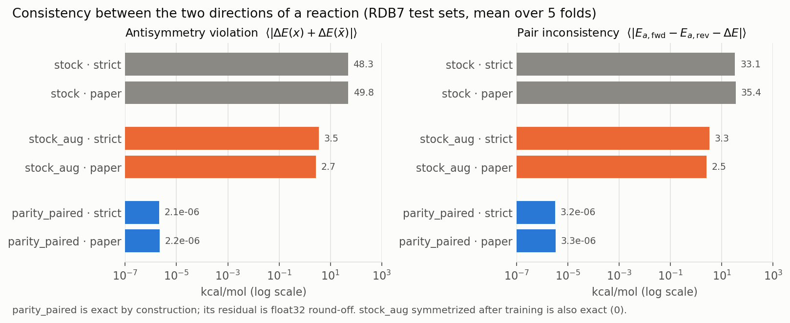
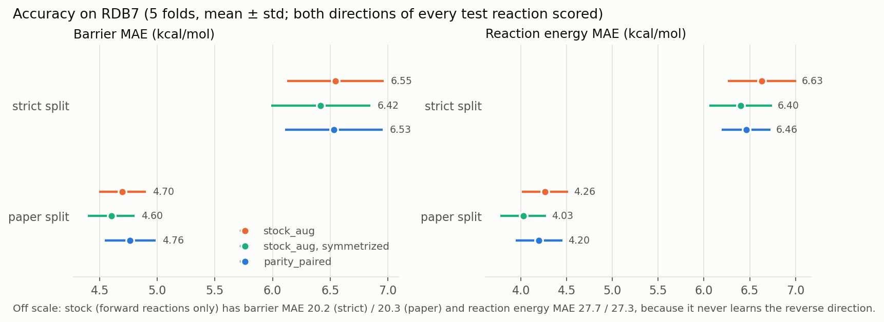
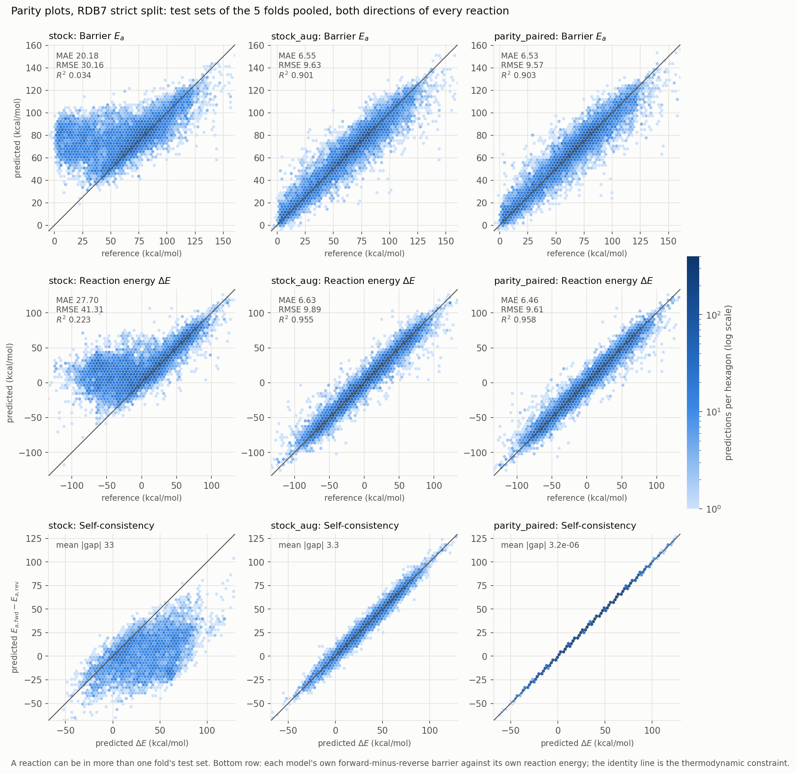
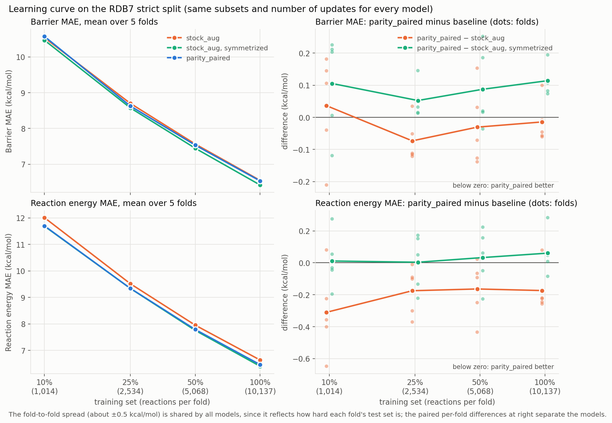

# RDB7 benchmark of `reversal_parity`

Scripts, derived data, splits and results of the RDB7 reaction-barrier benchmark of `ParityEquivariantMPNN` against stock Chemprop, following the protocol of Spiekermann, Pattanaik & Green, *J. Phys. Chem. A* **2022**, 126, 3976. The model checkpoints are not included.

The scripts are kept as they ran. They contain absolute paths of the machine they ran on (`/home/charlles/...`), so they document the runs rather than being turnkey; adjust the paths before rerunning.

## Key results

Three models predict the forward barrier $E_a$ and the reaction energy $\Delta E$ of each reaction:

- `stock`: Chemprop trained on forward reactions only;
- `stock_aug`: Chemprop trained on forward and reversed reactions, the approach of the original paper;
- `parity_paired`: `ParityEquivariantMPNN` trained on forward reactions only, with $E_a$ paired with $\Delta E$, so that $E_{a,\text{fwd}} - E_{a,\text{rev}} = \Delta E$ and $\Delta E(\bar x) = -\Delta E(x)$ hold by construction.

A fourth entry, `stock_aug, symmetrized`, is `stock_aug` corrected after training to satisfy the same two identities (see [Results](#results)). Every test reaction is scored in both directions, and all numbers are means over five scaffold-split folds.

### Consistency

The parity model's two directions agree to $2$–$3 \times 10^{-6}$ kcal/mol, which is float32 round-off. That is six orders of magnitude below `stock_aug`, whose forward and reverse predictions disagree by 2.5–3.5 kcal/mol on average, about half of its own error. `stock` never sees a reversed reaction and is inconsistent by 33–50 kcal/mol.

### Accuracy

- On barriers, `parity_paired` ties `stock_aug`: 6.53 against 6.55 kcal/mol on the strict split and 4.76 against 4.70 on the paper split. Both are within the fold-to-fold spread.
- On $\Delta E$, `parity_paired` beats `stock_aug` on both splits, by 0.17 (strict) and 0.06 kcal/mol (paper).
- `stock_aug` symmetrized after training is the most accurate model on both targets, by 0.06–0.17 kcal/mol.
- `stock` scores about 20 kcal/mol on barriers, because it cannot predict reverse barriers.

### Parity plots

The test sets of the five folds are pooled, with both directions of every reaction, so the statistics differ slightly from the fold means in the tables. The paper split looks the same: [`figures/parity_paper.png`](figures/parity_paper.png).

- **Top two rows (accuracy):** `stock` predicts the forward direction well but collapses on the reverse one. Reverse barriers come out as if they were forward barriers, a cloud at 60–100 kcal/mol whatever the reference, and $R^2$ drops to about 0. `stock_aug` and `parity_paired` scatter the same way around the diagonal ($R^2$ 0.90 for barriers and 0.96 for $\Delta E$ on the strict split, 0.94 and 0.98 on the paper split).
- **Bottom row (self-consistency):** each model's own $E_{a,\text{fwd}} - E_{a,\text{rev}}$ against its own $\Delta E$. Thermodynamics requires the identity line. `stock` is far from it, `stock_aug` lies in a band around it, and `parity_paired` lies on it exactly.

### Learning curve

With 10%, 25%, 50% and 100% of the strict training set, `parity_paired` stays within ±0.1 kcal/mol of `stock_aug` on barriers at every size. Its $\Delta E$ advantage is largest with the least data (0.31 kcal/mol at 10%), where `stock_aug`'s antisymmetry violation is also largest, and symmetrizing `stock_aug` after training removes it at every size. The built-in symmetry gives no data-efficiency gain here.

### Summary

- `parity_paired` is as accurate as `stock_aug` on barriers at every training size, while training on half as many datapoints, and its antisymmetry and pair consistency are exact.
- Its $\Delta E$ advantage over `stock_aug` is the antisymmetry constraint itself: symmetrizing `stock_aug` after training recovers it.
- Symmetrized `stock_aug` is the most accurate barrier model: ahead of `parity_paired` by 0.05–0.11 kcal/mol at every training size on the strict split, and by 0.16 kcal/mol on the paper split.
- Halving the odd feature block ($h$ basis) cost 0.10 kcal/mol of barrier MAE on the strict split (same sign on all five folds) and 0.02 on the paper split.

## Data

RDB7 (Spiekermann, Pattanaik & Green, *Sci. Data* **2022**, 9, 417; [Zenodo 6618262](https://zenodo.org/record/6618262), CC BY 4.0): about 12,000 gas-phase reactions with CCSD(T)-F12a/cc-pVDZ-F12//ωB97X-D3/def2-TZVP energies.

The targets are the ZPE-corrected forward barrier $E_a$ and the reaction energy $\Delta E = E_0(P) - E_0(R)$, in kcal/mol. The published dataset lists forward barriers only, so exact reverse barriers were rebuilt from the raw outputs:

| Step | Script | Input (from Zenodo) | Output |
|---|---|---|---|
| CCSD(T)-F12a energies | `parse_cc_logs.py` | `ccsdtf12_dz.tar.gz`, `ccsdtf12_dz.csv` | `data/cc_energies.csv` |
| ωB97X-D3 zero-point energies | `parse_zpe.py` | `wb97xd3.tar.gz` | `data/zpe.csv` |
| exact forward and reverse barriers | `build_exact.py` | the two files above | `data/rdb7_exact.csv` |

`build_exact.py` uses $E_0 = E_{\text{CCSD(T)}} + s \cdot \text{ZPE}$, with the scale $s$ fitted so that the forward barriers reproduce the published $\Delta E_0$. The reverse barrier is $E_0(\text{TS}) - E_0(P)$ with the same $s$. The three derived CSV files are included; the archives (1.5 GB) are not.

## Splits

`make_splits.py` reproduces Chemprop v1's balanced scaffold split on the forward reactant (85/5/10, seeds 0–4 for five folds), as in the authors' fork. Each reverse reaction joins its forward reaction's set.

- `splits_paper.json` (`--scaffold paper`): Murcko scaffolds of the atom-mapped reactant, as the authors' code computes them.
- `splits_strict.json` (`--scaffold strict`): atom maps cleared first, so that one scaffold is not split by its atom numbering. `scaffold_check.py` compares the two groupings.

## Models and training

`bench2.py MODEL FOLD SPLIT EPOCHS OUTDIR` trains one model on one fold, with the paper's architecture and settings: hidden size 900, depth 4, LeakyReLU, sum aggregation, Noam schedule $10^{-4} \to 10^{-3} \to 10^{-5}$ with 5 warm-up epochs, gradient clipping at 10, batch size 50, 100 epochs, checkpoint on validation loss. Ring-size features, $\Delta H$ as an input, DFT pretraining and ensembling are not reproduced.

| Model | Inputs | Targets |
|---|---|---|
| `stock` | Chemprop CGR (`REAC_DIFF`), forward reactions only | $[E_a, \Delta E]$ |
| `stock_aug` | Chemprop CGR, forward and reverse reactions (the paper's approach) | $[E_a, \Delta E]$ |
| `parity_paired` | `ParityCGRFeaturizer`, forward reactions only | $E_a$ paired with $\Delta E$ (`paired_difference={0: 1}`) |
| `parity` | as above | $[E_a$ free, $\Delta E$ odd$]$ |
| `parity_marcus` | as above | $[\tfrac12(E_{a,\text{fwd}} + E_{a,\text{rev}})$ even, $\Delta E$ odd$]$ |

Every test reaction is scored in both directions. `result.json` reports barrier errors pooled over both directions (`all_Ea_*`, the number comparable with the paper), per direction (`fwd_Ea_MAE`, `rev_Ea_MAE`), the $\Delta E$ errors, the antisymmetry violation $\langle|\Delta E(x) + \Delta E(\bar x)|\rangle$ (`antisym_dE_mean`) and the pair consistency $\langle|E_{a,\text{fwd}} - E_{a,\text{rev}} - \Delta E|\rangle$ (`consistency_MAE`). `preds.npz` holds the test predictions `Pf`, `Pr` and targets `Yf`, `Yr` for both directions.

## Results directories

| Directory | Runs | Code |
|---|---|---|
| `jpca_strict/`, `jpca_paper/` | all five models, folds 0–4 (November 11, 2026) | `stock`, `stock_aug`, `parity` and `parity_marcus` with `bench2_old_api.py` (the package before its rename to `reversal_parity`), launched as mixed batches of four models by `run2.sh`. The `parity_paired` runs here came from an intermediate `bench2.py` that was not kept; they are superseded by `_v2`. |
| `jpca_strict_v2/`, `jpca_paper_v2/` | `parity_paired`, folds 0–4 | `bench2.py` with the package at commit 42887e4, launched by `run3.sh` (five folds at once) |
| `jpca_strict_v3/`, `jpca_paper_v3/` | `parity_paired`, folds 0–4 | as `_v2`, but with an uncommitted variant of the featurizer whose odd block is $h = \tfrac12(x_p - x_r)$ instead of $d = x_p - x_r$; the variant was discarded |
| `lcurve_strict_md/frac{0.1,0.25,0.5}/` | `stock_aug` and `parity_paired` on 10%, 25% and 50% of the strict training set | `lcurve_strict_md/bench_lc.py`, generated from `bench2.py` by `make_bench_lc.py`, with the package at 42887e4 |

Training times are not comparable across directories: they depend on how many runs shared the GPU. Under identical conditions (the learning curve, five folds at once with `OMP_NUM_THREADS=1`), `parity_paired` trained about 6% faster than `stock_aug`.

`analysis/` holds the scripts behind the tables and figures: `compare_v2.py`, `symmetrize_stock_aug.py`, `analyze_lcurve.py` (with `lcurve_driver.py`, which ran the learning curve), `plot_summary.py` (all figures in `figures/`, including the parity plots; it needs NumPy and Matplotlib), and `timing/` for the timing study.

## Results

Mean ± standard deviation over five folds, kcal/mol. Barrier and $\Delta E$ errors pool both directions. "Symmetrized" is `stock_aug` corrected after training: $\Delta E \leftarrow \tfrac12[\Delta E(x) - \Delta E(\bar x)]$, then the nearest point with $E_{a,\text{fwd}} - E_{a,\text{rev}} = \Delta E$.

### Full training set

| Strict split | Barrier MAE | Barrier RMSE | $\Delta E$ MAE | $\Delta E$ RMSE | antisymmetry | consistency |
|---|---|---|---|---|---|---|
| `stock` | 20.18 ± 0.37 | 30.16 | 27.70 | 41.30 | 48 | 33 |
| `stock_aug` | 6.55 ± 0.42 | 9.61 | 6.63 | 9.85 | 3.5 | 3.3 |
| `stock_aug`, symmetrized | 6.42 ± 0.43 | 9.46 | 6.40 | 9.61 | 0 | 0 |
| `parity_paired` (`_v2`) | 6.53 ± 0.43 | 9.55 | 6.46 | 9.59 | $2 \times 10^{-6}$ | $3 \times 10^{-6}$ |
| `parity_paired`, $h$ basis (`_v3`) | 6.63 ± 0.42 | 9.69 | 6.51 | 9.47 | $2 \times 10^{-6}$ | $3 \times 10^{-6}$ |

| Paper split | Barrier MAE | Barrier RMSE | $\Delta E$ MAE | $\Delta E$ RMSE | antisymmetry | consistency |
|---|---|---|---|---|---|---|
| `stock` | 20.30 ± 0.68 | 31.25 | 27.25 | 41.98 | 50 | 35 |
| `stock_aug` | 4.70 ± 0.20 | 7.85 | 4.26 | 7.35 | 2.7 | 2.5 |
| `stock_aug`, symmetrized | 4.60 ± 0.20 | 7.75 | 4.03 | 7.11 | 0 | 0 |
| `parity_paired` (`_v2`) | 4.76 ± 0.22 | 7.90 | 4.20 | 7.23 | $2 \times 10^{-6}$ | $3 \times 10^{-6}$ |
| `parity_paired`, $h$ basis (`_v3`) | 4.78 ± 0.21 | 7.90 | 4.25 | 7.17 | $2 \times 10^{-6}$ | $3 \times 10^{-6}$ |

### Learning curve (strict split)

Each fold trains on a seeded random subset of its training reactions, nested across fractions and shared by both models; validation and test sets are the full ones. The number of gradient updates is held fixed: a fraction $1/K$ trains for $100K$ epochs with $5K$ warm-up epochs and validation every $K$ epochs. Differences are `parity_paired` minus the other model.

| Training set | Barrier MAE, `stock_aug` | Barrier MAE, `parity_paired` | vs `stock_aug`: barrier / $\Delta E$ MAE | vs symmetrized: barrier / $\Delta E$ MAE |
|---|---|---|---|---|
| 10% | 10.54 ± 0.60 | 10.57 ± 0.64 | +0.04 / −0.31 | +0.11 / +0.01 |
| 25% | 8.70 ± 0.55 | 8.63 ± 0.58 | −0.07 / −0.17 | +0.05 / +0.00 |
| 50% | 7.56 ± 0.50 | 7.53 ± 0.57 | −0.03 / −0.16 | +0.09 / +0.03 |
| 100% | 6.55 ± 0.42 | 6.53 ± 0.43 | −0.01 / −0.17 | +0.11 / +0.06 |

The 100% row uses `jpca_strict/stock_aug-f*` and `jpca_strict_v2/parity_paired-f*`.

## Discussion

### What the constraint buys

The parity model makes two statements about every reaction exact: the reaction energy changes sign under reversal, and the forward barrier minus the reverse barrier equals the reaction energy. Augmentation teaches both only approximately. After training on both directions, `stock_aug` still disagrees with itself by about 3 kcal/mol on average, which is half of its own error. For a single prediction this may not matter, but it does when predictions feed a kinetic model: forward and reverse rate constants built from inconsistent barriers violate detailed balance, and a mechanism generator would have to repair them. With the parity model, $k_f/k_r = K$ holds by construction, in every direction the model is asked about, and with no post-processing step that a user could forget.

### Why accuracy does not improve

The constraint does not make the model more accurate, and the learning curve shows that it does not make it more data-efficient either. Two observations explain most of this.

- **The symmetry group has two elements.** Reversal maps a reaction to its reverse and back, so augmentation already shows the network the whole orbit of every training reaction. The benefit of building an invariance into a model, rather than learning it, comes from the non-equivariant part of an unconstrained predictor, which augmentation leaves behind and a symmetrization removes (Elesedy & Zaidi, ICML 2021). With a two-element orbit that part is small: `stock_aug`'s antisymmetry violation is 3.5 kcal/mol on the strict split and 5.1 kcal/mol at 10% of the data. For large continuous groups, such as rotations, augmentation samples the orbit sparsely; that is the setting in which built-in equivariance has been found to improve data efficiency, with augmentation closing much of the gap given enough training (Brehmer et al., *Does equivariance matter at scale?*, arXiv:2410.23179, 2024).
- **Projection after training captures the same gain.** Symmetrizing `stock_aug` after training removes its non-equivariant part exactly, which is the same projection the parity model applies inside the network. The result is at least as accurate as the parity model at every training size. The parity model's $\Delta E$ advantage over raw `stock_aug` is therefore the constraint, not better learning.

The remaining 0.05–0.16 kcal/mol by which symmetrized `stock_aug` beats `parity_paired` on barriers has the same sign on nearly every fold but is unexplained. The two pipelines differ in more than the constraint: the featurizer (`ParityCGRFeaturizer` writes the element on both sides of the reaction, which `REAC_DIFF` does not), the optimization (`stock_aug` takes twice as many optimizer steps per epoch, each on 50 datapoints, while each parity step covers 50 reactions in both directions), and the loss, which for the parity model scores the forward barrier, the reverse barrier and the difference together. None of these was varied in isolation.

The $h$-basis run shows that the model is sensitive to the scale of the input features. Halving the odd block, which changes nothing about the symmetry, cost 0.10 kcal/mol on the strict split. The feature scale is a training-dynamics choice, not a modeling one; the package keeps the full difference, which matches the scale of Chemprop's `REAC_DIFF`.

### Cost

Under identical conditions the parity model trains about 6% faster per epoch than `stock_aug`. It encodes each reaction twice in one stacked pass, but it has half as many datapoints, so the work per epoch is about the same and there are fewer optimizer steps. Prediction costs twice the encoder work of a stock model, since every reaction is encoded in both directions.

### When to use it

The parity model is the better choice when forward and reverse predictions must agree, such as rate constants for a kinetic mechanism, equilibrium-consistent pairs, or uncertainty estimates that must transform correctly under reversal. It is also simpler to train: the data stay in one direction, and nothing has to be symmetrized afterward. When only the accuracy of one direction matters, augmentation followed by symmetrization is equally good on this benchmark.

### Limitations

- One dataset (RDB7, small gas-phase reactions) and one architecture (the paper's).
- One model per fold. GPU training is not bit-for-bit reproducible, and the run-to-run variation within a fold was not measured, so differences below about 0.1 kcal/mol should be read with care. The fold-to-fold spread (about ±0.5 kcal/mol) is shared by all models, since it reflects how hard each fold's test set is; the paired per-fold differences are the meaningful comparison.
- The learning curve uses one random subset per fold and size, on the strict split only.
- `stock`, `stock_aug` and the first `parity_paired` runs ran with an earlier version of the package API (see [Results directories](#results-directories)). The model and featurization code paths of `stock` and `stock_aug` did not change; `parity_paired` was rerun with the final code (`_v2`).
